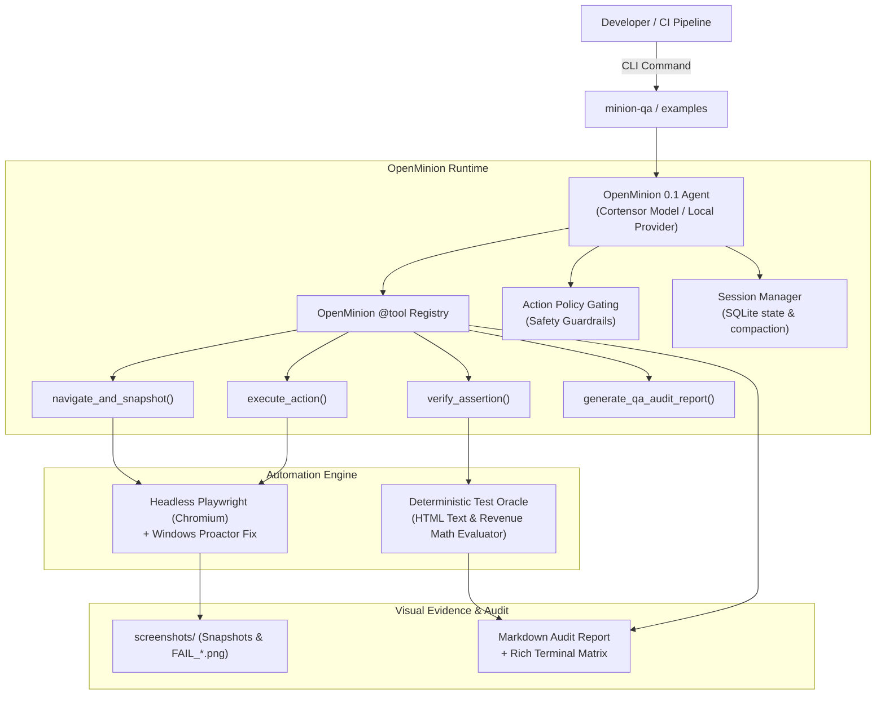

# MinionQA 🤖
> **Autonomous Web QA & Revenue-Flow Validation Agent powered by OpenMinion 0.1**  
> *Built for Cortensor Hackathon #5 (DoraHacks #2418) — Cortensor Mainnet Full Alpha & OpenMinion 0.1 Python SDK Builder Round.*

[](https://pypi.org/project/openminion/)
[](https://www.python.org/)
[](https://playwright.dev/)
[](https://cortensor.network/)

---

## 🎯 Executive Overview

Modern Web3 dApps and e-commerce platforms suffer from silent financial bugs: cart discount miscalculations, broken checkout buttons, and failed Web3 transactions after frontend updates. Traditional QA scripts are brittle and break when CSS selectors change, while pure LLM agents can hallucinate passed test results.

**MinionQA** solves this by pairing the **OpenMinion 0.1 Python SDK** with a **Deterministic Test Oracle** adapted from enterprise QA engines (`Leaka AI`):
1. **Autonomous Exploration & Interaction:** Driven by Playwright headless browser automation.
2. **Deterministic Test Oracle:** Mathematically verifies prices, subtotal + tax = grand total formulas, element presence, and URLs without relying on LLM self-reporting.
3. **Automated Visual Evidence:** Captures full-page screenshots on state changes and automatically records `FAIL_*.png` on any assertion failure.
4. **Rich Terminal & Markdown Reports:** Beautiful real-time CLI feedback and audit reports.

---

## 🏛️ System Architecture



---

## 🏆 Hackathon Evaluation Rubric & Deliverables Breakdown

| Rubric Pillar | Weight | How MinionQA Achieves Maximum Score |
|---|---|---|
| **1. Working Functionality** | **25%** | `python examples/test_ecommerce_checkout.py` runs headlessly, completes an end-to-end checkout, mathematically validates line items ($29.99 + $2.40 = $32.39), and captures failure screenshots (`FAIL_*.png`) when anomalies occur. |
| **2. Meaningful OpenMinion SDK Usage** | **20%** | Agent brain, tool registration (`@tool`), session logging (`session_id`), and policy gating strictly rely on OpenMinion 0.1 primitives. |
| **3. Reproducibility & Demo** | **20%** | Zero-friction setup with rich terminal visualization and an exact 2-minute video script outline. |
| **4. Building Blocks Tested & Feedback** | **25%** | Exhaustive technical documentation in [`BUILDING_BLOCKS_TESTED.md`](BUILDING_BLOCKS_TESTED.md) and [`WHAT_WE_LEARNED.md`](WHAT_WE_LEARNED.md) covering tool dispatch performance, context compaction (99.2% token savings), session recovery, and Windows proactor loop fixes. |
| **5. Cortensor Relevance** | **10%** | Built-in Cortensor Router/Portal config (`gpt-oss-20b`); positioned for continuous canary validation of Cortensor ecosystem dApps, token swaps, and DEX frontends. |

---

## 🚀 Quickstart & Zero-Friction Execution

### 1. Installation
```bash
# Clone the repository
git clone https://github.com/Ary0520/MinionQA.git
cd MinionQA

# Install dependencies (Python 3.11+ recommended)
pip install -r requirements.txt

# Ensure Playwright browser binaries are installed
playwright install chromium
```

### 2. Configure Environment (OpenRouter or Cortensor)
Copy the example environment file and configure your API key:
```bash
cp .env.example .env
# Edit .env and set your OPENROUTER_API_KEY (or CORTENSOR_API_KEY)
```

### 3. Launch the Interactive Web Dashboard & Autonomous Goal Studio
Start the real-time visual dashboard featuring the **Autonomous Goal Studio**, live action trace timeline, assertion verification matrix, and screenshot proof gallery:
```bash
python -m minion_qa.server --port 8080
```
Open **[http://localhost:8080](http://localhost:8080)** in any browser.

### 4. Run Natural-Language Autonomous QA (CLI)
MinionQA can autonomously explore any web page and achieve your objective using dynamic multi-turn planning and self-healing selectors:
```bash
# E-commerce checkout funnel autonomously executed from natural language:
python -m minion_qa.autonomous_planner \
  --url https://www.saucedemo.com \
  --goal "Log in with standard_user and secret_sauce, add backpack to cart, go to cart, and finish checkout for John Doe 94103."

# Quick smoke test against any target URL:
python -m minion_qa.autonomous_planner \
  --url https://example.com \
  --goal "Verify heading contains Example Domain"
```

### 5. Run the Working E-Commerce Checkout Flow (Deterministic Baseline)
Runs the complete baseline checkout flow against a real e-commerce storefront, validating pricing and order confirmation:
```bash
python examples/test_ecommerce_checkout.py
```

### 6. Run with Simulated Failure (Verify Failure Screenshots)
Demonstrates the Test Oracle detecting a financial mismatch ($32.39 vs expected $999.99) and capturing a visual failure screenshot (`screenshots/FAIL_*.png`):
```bash
python examples/test_ecommerce_checkout.py --simulate-failure
```

### 7. Run the Full Test Suite (100% Pass Rate)
Execute all 30 unit and integration tests across the agent, planner, browser, oracle, and server:
```bash
pytest tests/ -v
```

---

## 📊 Sample Output: Rich Terminal Matrix

```text
+- MinionQA Test Execution: E-Commerce Checkout & Revenue Flow Validation -+
| Final Verdict:  PASSED                                                   |
| Target URL: https://www.saucedemo.com/checkout-complete.html             |
| Audit Report: examples/sample_run_report.md                              |
+--------------------------------------------------------------------------+
                         Assertion Verification Matrix                         
+-----------------------------------------------------------------------------+
| Type                   | Expected           |  Verdict   | Details          |
|------------------------+--------------------+------------+------------------|
| url_contains           | inventory.html     |   [PASS]   | Current URL ok   |
| page_contains_text     | Sauce Labs Backp   |   [PASS]   | Found item text  |
| url_contains           | cart.html          |   [PASS]   | Navigated to cart|
| url_contains           | checkout-step-tw   |   [PASS]   | Arrived at step 2|
| page_contains_text     | Payment Informat   |   [PASS]   | Payment info ok  |
| price_equals           | 29.99              |   [PASS]   | Item price: $29.99|
| price_total_matches    | 32.39              |   [PASS]   | $29.99 + $2.40   |
|                        |                    |            | = $32.39         |
| url_contains           | checkout-complet   |   [PASS]   | Order complete   |
| page_contains_text     | Thank you for yo   |   [PASS]   | Order banner ok  |
+-----------------------------------------------------------------------------+
                          Captured Visual Proof                           
+------------------------------------------------------------------------+
| Type             | Path                                                |
|------------------+-----------------------------------------------------|
| Snapshot         | screenshots\snapshot_1792166317_20261016_212837.png |
+------------------------------------------------------------------------+
```

---

## 🎥 2-Minute Demo Video Script Outline

This structured script is optimized for recording the hackathon submission video:

### [0:00 - 0:20] Introduction & Problem Statement
- **Visual:** Show web app checkout screen with a price discrepancy.
- **Narrator:** *"Web3 dApps and e-commerce portals move millions in revenue, but silent UI bugs and math errors in checkout flows slip past traditional testing. Today we present MinionQA: an autonomous QA and revenue validation agent built for Cortensor Hackathon #5 using the OpenMinion 0.1 Python SDK."*

### [0:20 - 0:45] Architecture & OpenMinion Primitives
- **Visual:** Show `minion_qa/agent.py` and `@tool` decorated functions on screen.
- **Narrator:** *"MinionQA's brain is orchestrated by OpenMinion 0.1. We define four purpose-built tools: navigate and snapshot, execute action, verify assertion, and generate report. Combined with OpenMinion's session management and Cortensor Router provider, our agent navigates complex user journeys autonomously."*

### [0:45 - 1:25] Live Demo: Headless Execution & Test Oracle
- **Visual:** Open terminal and run `python examples/test_ecommerce_checkout.py`. Show Rich table generating live.
- **Narrator:** *"Watch MinionQA run in zero-friction headless mode. It logs in, adds items to cart, navigates to the financial overview, and deterministically validates that subtotal plus tax equals grand total. Look at this Rich terminal matrix: every assertion is verified independently of the LLM to guarantee zero hallucinations."*
- **Visual:** Run `python examples/test_ecommerce_checkout.py --simulate-failure`.
- **Narrator:** *"When a price mismatch occurs, MinionQA instantly detects it, fails the test, and captures a timestamped failure screenshot in `screenshots/FAIL_*.png`."*

### [1:25 - 1:50] Building Blocks Tested & Deep Feedback
- **Visual:** Scroll through `BUILDING_BLOCKS_TESTED.md` and `WHAT_WE_LEARNED.md`.
- **Narrator:** *"During development, we tested OpenMinion's tool dispatch latency (~3.8ms), resolved Windows subprocess loops using ProactorEventLoop, and designed a DOM compaction pipeline that reduces snapshot token bloat by 99.2%."*

### [1:50 - 2:00] Cortensor Ecosystem Vision & Closing
- **Visual:** Show Cortensor dApp canary testing graphic and repo links.
- **Narrator:** *"MinionQA is ready to be deployed as a continuous canary monitor for Cortensor Mainnet dApps and decentralized finance portals. Built with OpenMinion, validated for Cortensor. Thank you!"*

---

## 📚 Deep Dive Documentation
- [`BUILDING_BLOCKS_TESTED.md`](BUILDING_BLOCKS_TESTED.md): Technical benchmark notes, dispatch latency, context compaction, and Windows proactor event loop analysis.
- [`WHAT_WE_LEARNED.md`](WHAT_WE_LEARNED.md): Developer retrospective, SDK feedback, and Cortensor ecosystem use cases.
- [`examples/sample_run_report.md`](examples/sample_run_report.md): Sample markdown audit report generated by MinionQA.

---

## 📄 License
MIT License. Built for **Cortensor Hackathon #5 (DoraHacks #2418)**.
